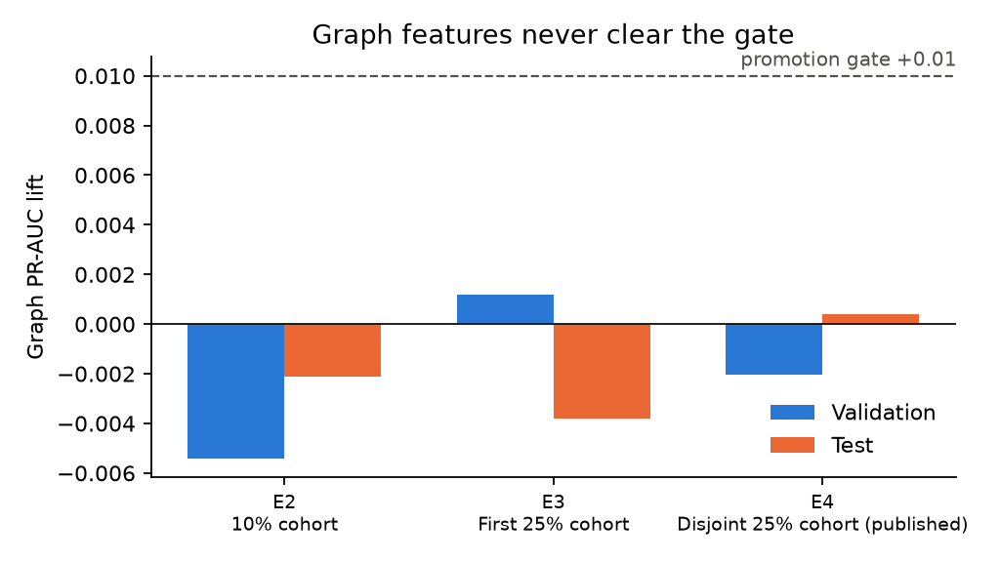
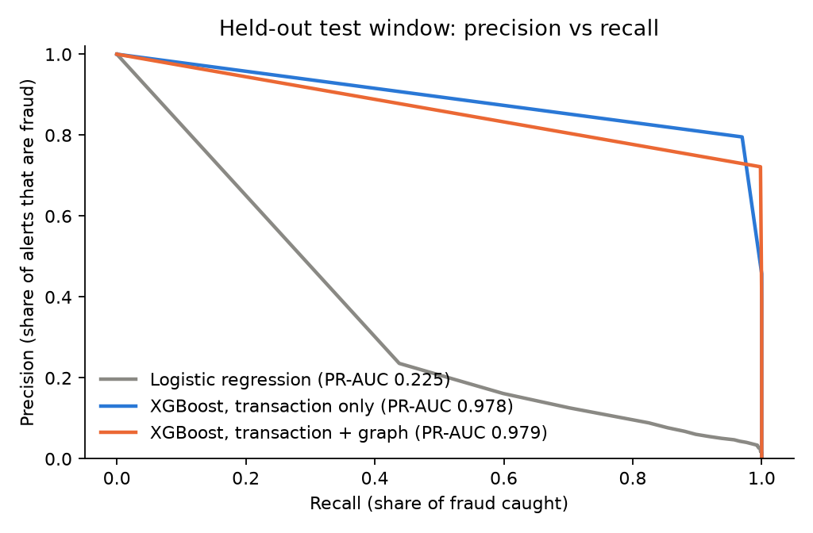
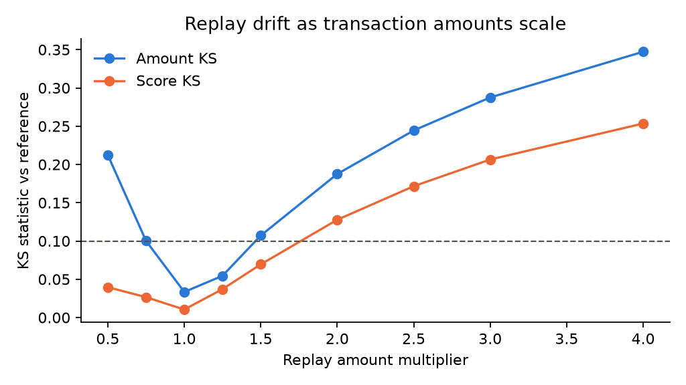
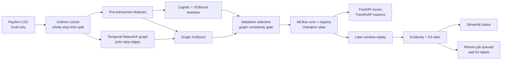

# Graph-Aware Fraud Detection with Drift Monitoring

[](https://github.com/AbhayJuloori/graph-aware-fraud-detection/actions/workflows/ci.yml)

A PaySim fraud experiment with time-safe graph features, an MLflow registry, a FastAPI scoring service with TreeSHAP reasons, Evidently drift reports, and a Streamlit monitor.

**[Interactive project page →](https://abhayjuloori.github.io/graph-aware-fraud-detection/)** · [Methodology](docs/methodology.md) · [Experiment log](docs/experiment-log.md)

> **Finding:** Graph features gave no dependable gain. On the disjoint confirmation cohort, transaction-only XGBoost reached **0.9785 test PR-AUC** and graph XGBoost **0.9789** (+0.0004); an earlier cohort showed **−0.0038** graph lift. A 0.01 absolute validation-lift gate kept the simpler model as champion. These are sampled synthetic-data results, not live fraud estimates.

## Results

The confirmation run used a **25% uniform, label-independent row cohort** of the original 6,362,620-row PaySim CSV (draw window `[0.25, 0.50)`, seed 42). Whole `step` values form train (≤281), validation (282–355), and later test (>355). Counts: train **955,801 / 812 fraud**, validation **323,099 / 208**, test **312,885 / 1,055**.

| Candidate | Validation PR-AUC | Test PR-AUC | Test recall at validation 1% FPR threshold | Realized test FPR |
|---|---:|---:|---:|---:|
| Class-weighted logistic regression | 0.0660 | 0.2251 | 61.7% | 1.13% |
| XGBoost, transaction only | **0.9367** | 0.9785 | **100.0%** | 1.08% |
| XGBoost, transaction + graph | 0.9347 | **0.9789** | **100.0%** | 1.20% |

Each decision threshold was chosen from validation negatives to target at most 1% false positives. The table reports what actually happened later. The graph model must beat the transaction-only model by 0.01 absolute validation PR-AUC to justify its added complexity. That gate was adopted after the first 25% cohort showed a tiny validation gain and a test loss; the disjoint second cohort is the published confirmation. Full precision is in [results.json](docs/results.json), and the [experiment log](docs/experiment-log.md) preserves both attempts.

PaySim is synthetic and unusually separable. High test PR-AUC does not establish a useful live fraud policy. Validation has relatively few fraud cases, and graph lift changes sign across the two cohorts. The supported conclusion is **no demonstrated graph lift**.

## Why the graph adds nothing here



- **No repeat actors.** 99.85% of senders appear exactly once. On held-out rows, sender degree is non-zero 0.1% of the time; shared counterparties and ring flags are never non-zero. Only 0.5% of fraud receivers are reused.
- **One generator pattern dominates.** 97.8% of fraud drains the full origin balance (0.0002% of legitimate TRANSFER/CASH_OUT rows do). `amount / oldbalanceOrg` has mean |SHAP| 6.4 log odds, about 6× the next feature.
- **Generous operating point.** The validation 1% FPR threshold catches every test fraud but only 24% of alerts are fraud; around 0.12% FPR still recovers 99.9% recall.
- **Drift costs investigators.** The alert fires at ≤0.75× and ≥1.5× amounts; at 3× the alert volume per 100k transfers quadruples (1,415 → 5,737). Daily checks on unshifted data fire on 5 of 17 days, so a real monitor needs volume guards.

<p> </p>

## Architecture



**Leakage controls.** The API accepts only `step`, `type`, `amount`, sender/receiver IDs, and *pre-transaction* balances. `newbalanceOrig`, `newbalanceDest`, and `isFlaggedFraud` are excluded. Each step's graph features are computed before its edges and labels enter the graph. Training labels update neighborhood fraud rates after the step; validation and test labels never do. PageRank and weak components refresh every 168 steps, while degrees use the latest earlier-step graph. `same_component_flag` is a coarse community proxy, and `ring_flag` marks a possible three-node undirected closure. A graph champion would serve from the frozen training-cutoff snapshot.

**Model choice and serving.** Three prespecified candidates use the same cohort and split. The champion is selected from validation only, then the later test is evaluated. MLflow stores runs and versions the champion. `/score` loads its `champion` alias and returns probability, model version, and the three largest signed TreeSHAP contributions in log-odds units.

**Monitoring.** Validation scores are the reference; the later window is replayed as current data. Evidently writes an HTML feature-and-score report. A reproducible 20,000-row two-sample KS check alerts if amount or score has statistic ≥0.10 and p<0.01. `--amount-multiplier 3` changes amount and **rescores** the replay. An alert queues a retrain request, which waits for mature labels. Streamlit refreshes status every 30 seconds.

## Run locally

Python 3.12 and [`uv`](https://docs.astral.sh/uv/) are recommended. Download the original [PaySim dataset](https://www.kaggle.com/datasets/ealaxi/paysim1) with Kaggle access. The source listing reports **CC BY-SA 4.0**; raw rows and local model artifacts stay out of Git.

```bash
uv sync --python 3.12 --extra dev --no-editable
mkdir -p data/raw
kaggle datasets download -d ealaxi/paysim1 -p data/raw --unzip
uv run --no-editable fraud-lab train --sample-fraction 0.25 --sample-start 0.25
python scripts/export_results.py
uv run --no-editable fraud-lab report
uv run --no-editable fraud-lab monitor
uv run --no-editable fraud-lab monitor --amount-multiplier 3
uv run --no-editable uvicorn fraud_lab.api:app --reload
uv run --no-editable streamlit run app.py
```

`fraud-lab report` reads the raw CSV and local artifacts and writes only aggregates: `site/data/summary.json` (the project page), `docs/results/summary.json`, and `docs/figures/*.png`. Preview the page with `python -m http.server -d site`.

Open `http://localhost:8000/docs` for the API and `http://localhost:8501` for the dashboard (tabs: live monitor, hand scorer with reason codes, model evidence). The [demo notebook](notebooks/demo.ipynb) reads committed aggregate results without the raw CSV. MLflow UI: `uv run mlflow ui --backend-store-uri sqlite:///$(pwd)/mlflow.db`.

```bash
curl -X POST http://localhost:8000/score -H 'Content-Type: application/json' \
  -d '{"step":400,"type":"TRANSFER","amount":100000,"nameOrig":"C123","oldbalanceOrg":100000,"nameDest":"C456","oldbalanceDest":0}'
```

After an alert, once mature labels are available in a refreshed full-history CSV, run `fraud-lab retrain --labeled-csv path/to/refreshed.csv`. This repeats chronological evaluation and registers a new version. The amount-shift demo does not create new labels, so it does not train automatically.

## Docker and CI

```bash
docker compose build
docker compose run --rm train
docker compose up api dashboard
```

Compose shares MLflow and artifact volumes. Its training command uses the default 10% sample for a quick container demo. GitHub Actions runs Ruff and synthetic-data tests; it does not download PaySim.

## Repository map

| Path | Role |
|---|---|
| `src/fraud_lab/data.py`, `features.py` | Cohort sampling, time split, pre-event and graph features |
| `src/fraud_lab/training.py` | Three candidates, metrics, MLflow registration |
| `src/fraud_lab/serving.py`, `api.py` | Registry-backed scoring and TreeSHAP reasons |
| `src/fraud_lab/monitoring.py`, `app.py` | Evidently, alerts, retrain queue, Streamlit |
| `src/fraud_lab/diagnostics.py`, `report.py` | Curves, SHAP, graph coverage, drift sweep, figures |
| `site/` | Interactive project page (D3, GitHub Pages) |
| `docs/methodology.md` | Full method, results, and limits |
| `docs/results.json` | Portable aggregate measurements |
| `docs/experiment-log.md` | Rehearsal, failed graph inference, confirmation |
| `docs/production-notes.md` | What I would change in production |

## License

Code and documentation: MIT. PaySim data is obtained separately under the source dataset's [CC BY-SA 4.0 terms](https://www.kaggle.com/datasets/ealaxi/paysim1/metadata); it is not redistributed here.
